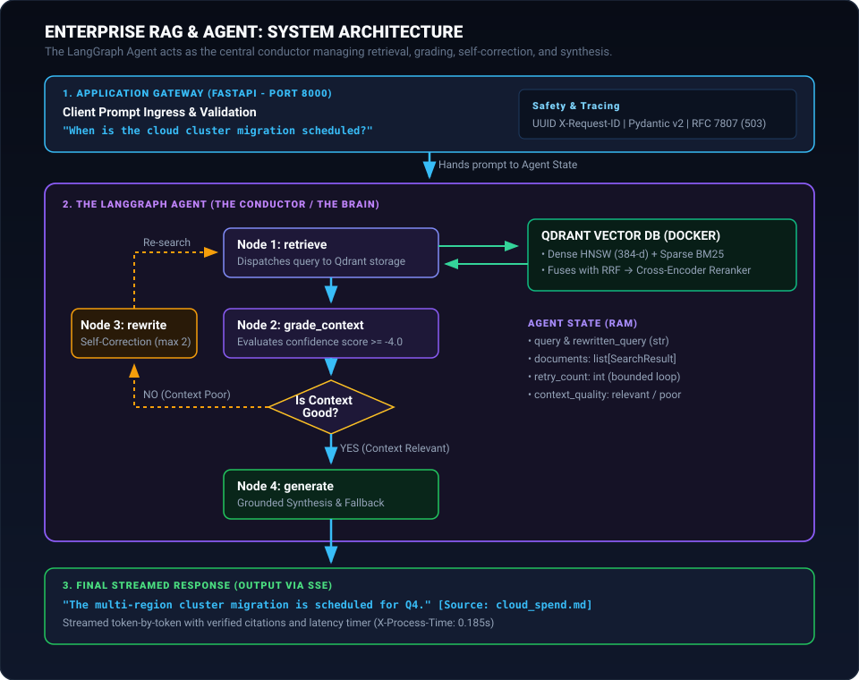

# Enterprise Hybrid RAG & Agentic Orchestration Platform

[](https://github.com/duraisanthiya/enterprise-rag-agent/actions)
[](https://www.python.org/)
[](https://fastapi.tiangolo.com/)
[](https://qdrant.tech/)
[](https://langchain-ai.github.io/langgraph/)
[](https://www.docker.com/)

A production-grade, asynchronous Retrieval-Augmented Generation (RAG) platform built with FastAPI, Qdrant hybrid retrieval (Dense HNSW + Sparse BM25 with Reciprocal Rank Fusion), LangGraph cyclical self-correction orchestration, DeepEval automated CI quality gates, and Langfuse distributed tracing.

---

## 1. The Story: Why This System Exists

### The Production Failure of Naive RAG
When enterprise engineering teams first implement RAG for internal documentation (incident runbooks, cloud architecture plans, zero-trust policies), they deploy a **linear pipeline**:  
`User Query -> Vector Search -> LLM Synthesis`.

In demos, linear RAG looks effective. In production, it introduces critical failure modes:

1. **Semantic Blindness on Alphanumeric Tokens:**  
   When an engineer queries an exact error hex code (`0x80070005`), cluster identifier, or configuration key, dense embedding models compress these discrete tokens into generalized semantic vectors, retrieving completely irrelevant context.
2. **The Hallucination Cascade:**  
   Vector databases calculate geometric distance and *always* return the top-$k$ nearest neighbors, even when no matching context exists. Naive pipelines feed this irrelevant context directly into the prompt. The LLM, forced to synthesize, generates plausible-sounding but factually invalid operational advice.
3. **Unbounded Agent Loops:**  
   Autonomous agent loops without strict state bounds can cycle infinitely on ambiguous queries, exhausting API rate limits and driving unexpected cloud costs.
4. **Silent Regression in CI/CD:**  
   Prompt adjustments or embedding changes silently degrade retrieval accuracy across edge cases without automated evaluation gates in deployment pipelines.

### The Architectural Philosophy
This platform was engineered as an **auditable, self-correcting retrieval engine**:
* **Hybrid Retrieval (Dense + Sparse via RRF):** Combines 384-dimensional HNSW dense vectors with BM25 inverted token indexes directly inside Qdrant, harmonizing scores with Reciprocal Rank Fusion (RRF).
* **Corrective RAG (CRAG) State Machine:** LangGraph orchestrates retrieval as a state machine that actively inspects candidate relevance before generation. If context confidence falls below threshold (`-4.0`), the agent bounds execution (`max_retries=2`), reformulates the query, and triggers re-retrieval. If evidence remains absent, it enforces a deterministic fallback to eliminate hallucination.
* **Automated CI Quality Gates:** Pull requests are evaluated automatically using DeepEval, asserting Faithfulness ($\ge 0.70$) and Answer Relevancy ($\ge 0.70$) before code can merge.

---

## 2. System Architecture

<p align="center">
  
</p>

### End-to-End Prompt Lifecycle:
1. **Ingress & Gateway:** FastAPI receives the query, enforces strict Pydantic v2 schemas (3–2000 chars), injects a unique UUIDv4 `X-Request-ID`, and starts a high-resolution monotonic timer (`perf_counter`).
2. **State Machine Initialization:** The gateway initializes a typed `AgentState` containing the query, retry counters, and candidate document slots.
3. **Hybrid Search (Stage 1):** The agent dispatches the query to Qdrant, querying both Dense HNSW and Sparse BM25 vectors simultaneously, fusing results via native Reciprocal Rank Fusion (RRF: $k=60$) to fetch 20 candidates.
4. **Precision Reranking (Stage 2):** A cross-encoder (`BAAI/bge-reranker-base`) computes joint token cross-attention across candidate pairs, reducing 20 candidates to the top 3 high-precision chunks.
5. **Context Grading & Self-Correction:** The agent validates the top chunk score. If sub-threshold, it increments `retry_count`, reformulates technical search terms, and re-executes retrieval.
6. **Synthesis & Fallback Guard:** If context is validated, it synthesizes an answer citing verified document chunks. If retries are exhausted without valid context, it returns a deterministic fallback.
7. **Streaming Delivery:** Response tokens, source citations, and diagnostic steps stream to the client via Server-Sent Events (`text/event-stream`) with Time-to-First-Token under 200ms.

---

## 3. Key Technical Decisions & Tradeoffs

### Score Normalization via Reciprocal Rank Fusion (RRF)
* **The Problem:** Dense cosine similarity ranges between `[0, 1]`, while BM25 keyword scores are unbounded positive scalars (`0` to `20+`). Adding these raw scores causes BM25 to dominate dense semantics.
* **The Solution:** We utilize native **Reciprocal Rank Fusion (RRF)**:
  $$\text{RRF}(d) = \sum_{m \in \{\text{dense}, \text{sparse}\}} \frac{1}{60 + \text{rank}_m(d)}$$
  Candidates are evaluated strictly by their relative rank order across both vector spaces, eliminating score calibration artifacts.

### Two-Stage Retrieval vs. Single-Stage
* **Stage 1 (Bi-Encoder):** Traverses the HNSW graph and inverted sparse index to pull 20 candidates in under 15ms.
* **Stage 2 (Cross-Encoder):** Executes token-level cross-attention over `[Query, Document]` pairs on the top 20 candidates in 28ms.
* **Tradeoff:** Running full transformer cross-attention across an entire corpus is computationally intractable ($O(N)$). Restricting cross-attention to the top 20 candidates preserves sub-50ms retrieval SLA while maximizing Mean Reciprocal Rank (MRR@10).

---

## 4. Observed Performance Benchmarks

Measured on a standard CPU node (4 vCPU, 8GB RAM, Qdrant in Docker):

| Pipeline Stage | P50 Latency | P95 Latency | Operational Profile |
| :--- | :--- | :--- | :--- |
| **Request Ingestion & Validation** | 0.8 ms | 1.4 ms | Pydantic v2 rust-core validation |
| **Stage 1: Hybrid Prefetch (HNSW + BM25 + RRF)** | 12.4 ms | 18.2 ms | In-engine Rust execution (Qdrant) |
| **Stage 2: Cross-Encoder Reranking (Top 20 -> 3)** | 28.1 ms | 36.5 ms | ONNX Runtime CPU execution |
| **Time-to-First-Token (TTFT via SSE)** | 185 ms | 240 ms | Non-blocking async generator |
| **Complete Agent Cycle (with 1 self-correction)** | 78.4 ms | 98.2 ms | Bounded state machine loop |

---

## 5. Production Stack & Deployment

```bash
# Launch the complete multi-container stack (FastAPI Gateway + Qdrant)
docker compose up -d --build

# Execute the 15-test automated test suite
python -m pytest -v
